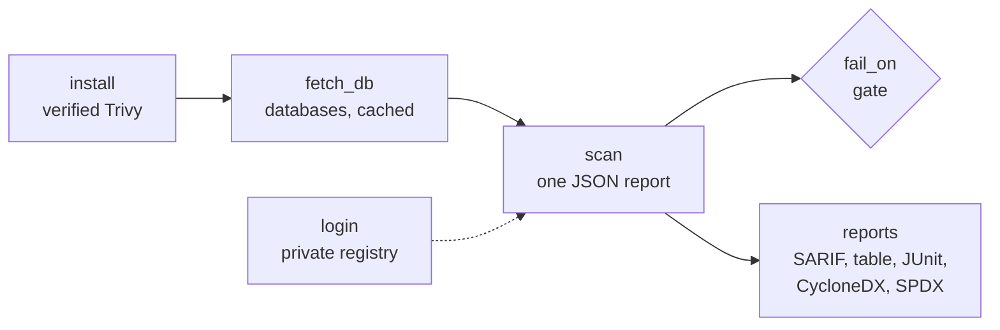

<div align="center">


# Trivy for CircleCI and GitHub Actions

### Scan images, code, infrastructure as code and SBOMs with a checksum-verified Trivy, and gate on what it finds.

Install a checksum-verified [Trivy](https://trivy.dev/), cache its vulnerability database between jobs, and scan container images, directories, repositories, Kubernetes, Terraform and Dockerfiles, and SBOMs for vulnerabilities, misconfigurations, secrets and licenses, as orb commands or GitHub Actions.<br>
Releases an attacker published refused, in every mode · One scan, every report: JSON, SARIF, table, JUnit, CycloneDX, SPDX<br>
A severity gate that tells findings from failures · Stale databases caught · Offline scans for air-gapped runners · No telemetry · No `sudo`

[](https://circleci.com/gh/juburr/trivy-orb)
[](https://github.com/juburr/trivy-orb/actions/workflows/actions.yml)
[](https://circleci.com/developer/orbs/orb/juburr/trivy-orb)
[](LICENSE)
[](https://discuss.circleci.com/c/ecosystem/orbs)


**[Quick Start](#-quick-start)** · **[Features](#-why-trivy-orb)** · **[Recipes](#-recipes)** · **[Commands](#-commands)** · **[GitHub Actions](#-github-actions)** · **[Security](#-secure-by-design)** · **[Network Access](#-network-access)**

<sub>An unofficial, community-maintained CircleCI orb and set of GitHub Actions, not affiliated with Aqua Security. [Contributions are welcome!](#-contributing)</sub>

</div>

<br>

## ✨ Why trivy-orb?

<table>
<tr>
<td width="33%" valign="top">
📦 <b>A verified Trivy, never a hijacked one</b><br><br>
<code>install</code> checks Trivy against this orb's SHA-512 table before it runs, and refuses <b>0.69.4</b>, the release an attacker published with stolen credentials in March 2026, even with verification turned off. Every table entry was checked against the release's signed checksums.
</td>
<td width="33%" valign="top">
🚦 <b>A gate you can trust</b><br><br>
<code>fail_on</code> fails the step on findings at or above a severity, and <code>report_only</code> reports them instead. A scan that can't complete, a stale database, or one that found nothing to check fails either way, instead of passing on nothing.
</td>
<td width="33%" valign="top">
🗂️ <b>One scan, every report</b><br><br>
Trivy scans once into JSON; SARIF, a table, CycloneDX and SPDX SBOMs and a GitHub dependency snapshot are rendered from it, so every report describes the same scan. JUnit puts each finding in CircleCI's Tests tab.
</td>
</tr>
<tr>
<td width="33%" valign="top">
🗄️ <b>Databases that keep up</b><br><br>
<code>fetch_db</code> caches the vulnerability database between jobs, keyed by its build, so jobs download it only when a newer one is out, and the scans after it never download it again. Point it at your own mirror with <code>db_repository</code>.
</td>
<td width="33%" valign="top">
✈️ <b>Offline and air-gapped</b><br><br>
Fetch the databases and checks bundle once, pass them through the workspace, and scan with <code>offline: true</code>: no registry, no Maven lookups, no telemetry, and a scan that fails when the database is older than you allow.
</td>
<td width="33%" valign="top">
🔑 <b>Private registries</b><br><br>
<code>login</code> stores the credentials where Trivy and Docker read them, the password only ever on stdin, and a registry that issues tokens checks them right away; <code>logout</code> removes them. Images are pulled straight from the registry, so no Docker daemon is needed.
</td>
</tr>
</table>

### 🧩 The Orb vs. a Hand-Rolled Script

| | Hand-rolled | trivy-orb |
|---|---|---|
| Installing Trivy | `curl \| sh`, or `trivy-action` by tag (both hijacked in March 2026) | SHA-512 verified, compromised releases refused, cached, mirrored if you like |
| Failing on findings | `--exit-code 1`, the same code as a crash | findings and failures told apart, and every report written either way |
| A scan that checked nothing | passes | fails, unless you allow it |
| A stale database | used silently | fails past `max_db_age_days` |
| Reports | one format per scan | JSON, SARIF, table, JUnit, CycloneDX, SPDX from one scan |
| The database | downloaded by every job, rate-limited | cached by its build, fetched once per job |
| Telemetry | sent unless turned off twice | never sent |

## 🔄 How It Works



1. **`install`** puts a verified Trivy on the `PATH`.
2. **`fetch_db`** fetches the vulnerability database (and, if you like, the Java database and checks bundle), restored from and saved to the cache, and exports `TRIVY_CACHE_DIR`.
3. **`login`**, for a private registry, stores its credentials.
4. **`scan`** runs Trivy once, writes its JSON report, renders the other formats from it, and fails the step on findings at or above `fail_on`.

## 🚀 Quick Start

### CircleCI

```yaml
version: 2.1

orbs:
  trivy: juburr/trivy-orb@0.1.0

jobs:
  scan:
    docker:
      - image: cimg/base:current
    steps:
      - checkout
      - trivy/install
      - trivy/fetch_db
      - trivy/scan:
          target: ghcr.io/my-org/my-app:1.0
      - trivy/scan:
          target_type: filesystem
          target: .
          report_name: checkout

workflows:
  scan:
    jobs:
      - scan
```

The image scan fails on any vulnerability, secret or license at or above HIGH; the reports are in the job's artifacts under `trivy-reports/`, and the findings in its Tests tab.

### GitHub Actions

```yaml
jobs:
  trivy:
    runs-on: ubuntu-24.04
    permissions:
      contents: read
      security-events: write
    steps:
      - uses: actions/checkout@v7
      - uses: juburr/trivy-orb/actions/install@v0.1.0
      - uses: juburr/trivy-orb/actions/fetch_db@v0.1.0
      - uses: juburr/trivy-orb/actions/scan@v0.1.0
        with:
          target_type: filesystem
          target: .
          scanners: vuln secret misconfig
      - uses: github/codeql-action/upload-sarif@v4
        if: always()
        with:
          sarif_file: /tmp/trivy-reports/trivy.sarif
```

## 🍳 Recipes

### Scan an Image Before Pushing It

On a machine executor, scan the image you just built straight from Docker, and push it only if the scan passes:

```yaml
steps:
  - checkout
  - run: docker build -t ghcr.io/my-org/my-app:${CIRCLE_SHA1} .
  - trivy/install
  - trivy/fetch_db
  - trivy/scan:
      target: ghcr.io/my-org/my-app:${CIRCLE_SHA1}
      image_src: docker
      ignore_unfixed: true
  - run: docker push ghcr.io/my-org/my-app:${CIRCLE_SHA1}
```

An image saved with `docker save`, or an OCI layout directory, scans with `input` in place of `target`.

### Choose What Fails the Build

- **`fail_on`** (default `high`) is the lowest severity that fails the step: `critical`, `high`, `medium`, `low` or `unknown`. Findings below it are still reported, as skipped tests in JUnit.
- **`report_only: true`** reports every finding without failing the step, to adopt the scan gradually.
- **`severity`** (such as `HIGH,CRITICAL`) leaves the other severities out of every report.
- **`ignore_unfixed: true`** leaves out vulnerabilities that have no fix yet.
- **`fail_on_eol: true`** also fails on an end-of-life OS, whose new vulnerabilities go unreported.

A finding is a vulnerability, a misconfiguration check that failed, a secret, or a license (Trivy grades licenses by category: forbidden is CRITICAL, restricted HIGH, reciprocal MEDIUM, notice and permissive LOW, and unknown UNKNOWN, so the default `fail_on: high` fails only on forbidden and restricted ones).

### Suppress Accepted Findings

A `.trivyignore` in `working_dir` (one ID per line, `# comments` and `exp:2026-12-31` allowed) or a `.trivyignore.yaml` (which this orb picks up when there is no `.trivyignore`; Trivy itself doesn't) suppresses findings. So do VEX documents:

```yaml
- trivy/scan:
    target: ghcr.io/my-org/my-app:1.0
    vex: vex/my-app.openvex.json
```

Suppressed findings are counted in the summary and the run record, so they never disappear without a trace. The exception is `target_type: config`, whose Trivy command can't report them; `target_type: filesystem` with `scanners: misconfig` checks the same files and does.

### Scan the Checkout: Dependencies, Secrets and Infrastructure as Code

```yaml
- trivy/scan:
    target_type: filesystem
    target: .
    scanners: vuln secret misconfig
    skip_dirs: node_modules,vendor
- trivy/scan:
    target_type: config
    target: deploy
    report_name: deploy
```

`filesystem` reads lockfiles (package-lock.json, go.mod, poetry.lock and the like) and secrets; `config` checks Dockerfiles, Kubernetes manifests, Helm charts, Terraform and CloudFormation.

### Write SBOMs

```yaml
- trivy/scan:
    target: ghcr.io/my-org/my-app:1.0
    formats: sarif table cyclonedx spdx-json
```

writes `trivy.cdx.json` and `trivy.spdx.json`, with every package and its vulnerabilities, from the same scan. Scan an SBOM later with `target_type: sbom`.

### Scan Offline, or on Air-Gapped Runners

Fetch the databases once and scan with them in later jobs, which never reach Trivy's registries:

```yaml
jobs:
  fetch-databases:
    docker:
      - image: cimg/base:current
    steps:
      - trivy/install
      - trivy/fetch_db:
          cache_dir: /tmp/workspace/trivy
          checks_bundle: true
          db_repository: artifactory.example.com/aquasec/trivy-db:2
      - persist_to_workspace:
          root: /tmp/workspace
          paths: [trivy]
  scan:
    docker:
      - image: cimg/base:current
    steps:
      - checkout
      - attach_workspace:
          at: /tmp/workspace
      - trivy/install:
          download_base_url: https://artifactory.example.com/github
      - trivy/scan:
          target_type: filesystem
          target: .
          cache_dir: /tmp/workspace/trivy
          offline: true
          max_db_age_days: 2
```

### Scan a Private Registry

```yaml
- trivy/login:
    registry: registry.example.com
    username: REGISTRY_USERNAME
    password: REGISTRY_PASSWORD
- trivy/scan:
    target: registry.example.com/my-org/my-app:1.0
    image_src: remote
- trivy/logout:
    registry: registry.example.com
```

`username` and `password` name environment variables, such as a context's; Trivy also reads Docker's own login and, for ghcr.io, `GITHUB_TOKEN`.

### Keep a Run Record

`run_record: true` writes `<report_name>.run-record.json`: the trivy that ran and its SHA-512, its arguments, what it scanned (image digests included), the databases it scanned with, the gate's settings, the counts, and each report's SHA-256, described by [`schemas/run-record.v1.json`](schemas/run-record.v1.json). It answers "what exactly did we check, and with what?" for an audit, without running the scan again.

## 🧰 Commands

| Command | What it does |
|---|---|
| [`install`](#trivyinstall) | Installs Trivy, verified against this orb's checksum table |
| [`fetch_db`](#trivyfetch_db) | Fetches Trivy's databases, cached between jobs, for later scans |
| [`scan`](#trivyscan) | Scans an image, directory, root filesystem, repository, IaC or SBOM, and gates on its findings |
| [`login`](#trivylogin) | Logs in to a registry for scans of its private images |
| [`logout`](#trivylogout) | Logs out of a registry |

Every parameter that names a value (`version`, `target`, `db_repository` and the like) expands environment variables, except `output_dir`, which `store_artifacts` reads too. Credentials are always the *name* of an environment variable, never the secret.

### `trivy/install`

| Parameter | Default | Description |
|---|---|---|
| `version` | `0.76.1` | Release to install, from 0.69.2 on (see [Checksum Verification](#-checksum-verification)) |
| `verify_checksums` | `strict` | `strict`, `known_versions` or `false` |
| `install_path` | `~/bin` | Directory for `trivy`, added to the `PATH` |
| `download_base_url` | | An https mirror of GitHub Releases, in place of `https://github.com` |
| `caching` | `true` | Cache the verified release between jobs |

### `trivy/fetch_db`

| Parameter | Default | Description |
|---|---|---|
| `cache_dir` | `~/.cache/trivy` | Where to fetch the databases; exported as `TRIVY_CACHE_DIR` |
| `java_db` | `false` | Also fetch the Java database, for JARs in images |
| `checks_bundle` | `false` | Also fetch the misconfiguration checks bundle, for offline scans |
| `db_repository` | | The vulnerability database's repositories, such as a mirror; exported for later scans |
| `java_db_repository` | | The Java database's repositories |
| `checks_bundle_repository` | | The checks bundle's repository |
| `max_db_age_days` | `7` | Fail when the database fetched is older than this; `0` for no limit |
| `timeout` | | Trivy's `--timeout` for each download, such as `15m` |
| `caching` | `true` | Cache the databases between jobs, keyed by their build |

It exports `TRIVY_CACHE_DIR`, and `TRIVY_ORB_DB_DIR` (and `TRIVY_ORB_JAVA_DB_DIR`, `TRIVY_ORB_CHECKS_DIR`), which tell `scan` not to update what it fetched.

### `trivy/scan`

| Parameter | Default | Description |
|---|---|---|
| `target_type` | `image` | `image`, `filesystem`, `rootfs`, `repository`, `config` or `sbom` |
| `target` | | The image, directory, repository or SBOM to scan |
| `input` | | An image archive or OCI layout to scan instead of `target` |
| `scanners` | | `vuln`, `misconfig`, `secret`, `license`. Default: Trivy's (`vuln,secret`; `config`: misconfigurations) |
| `fail_on` | `high` | The lowest severity that fails the step |
| `fail_on_eol` | `false` | Also fail on an end-of-life OS |
| `report_only` | `false` | Report findings without failing the step |
| `severity` | | Severities to report, such as `HIGH,CRITICAL`. Default: all |
| `ignore_unfixed` | `false` | Leave out vulnerabilities without a fix |
| `ignore_file` | | Default: `.trivyignore`, or `.trivyignore.yaml` |
| `vex` | | VEX documents, or `repo`, `oci`, `sbom-ref` |
| `pkg_types` | | `os`, `library`, or both |
| `skip_dirs`, `skip_files` | | Globs to leave out |
| `image_src` | | Where to find an image: `docker`, `containerd`, `podman`, `remote` |
| `platform` | | The platform of a multi-platform image, such as `linux/arm64` |
| `cache_dir` | | Default: `TRIVY_CACHE_DIR` from `fetch_db`, or `~/.cache/trivy` |
| `offline` | `false` | Use the databases in `cache_dir` without updating them |
| `max_db_age_days` | `7` | Fail when the vulnerability database is older than this; `0` for no limit |
| `allow_empty` | `false` | Pass a scan that found nothing to check |
| `timeout` | | Trivy's `--timeout`, such as `15m` |
| `formats` | `sarif,table` | Reports besides JSON: `sarif`, `table`, `cyclonedx`, `spdx-json`, `github` |
| `extra_args` | | More Trivy arguments, split like shell words |
| `working_dir` | `.` | The directory to run in |
| `output_dir` | `/tmp/trivy-reports` | Where the reports go |
| `report_name` | `trivy` | The reports' file name |
| `junit` | `true` | Write the findings as JUnit, for the Tests tab |
| `run_record` | `false` | Write a run record |
| `store_artifacts` | `true` | Store `output_dir` as artifacts under `trivy-reports/` |
| `no_output_timeout` | `10m` | How long the scan may be silent |

Trivy's own `TRIVY_*` variables and a `trivy.yaml` in `working_dir` still set the options this command doesn't, such as `TRIVY_INSECURE` or `TRIVY_USERNAME`.

### `trivy/login`

| Parameter | Default | Description |
|---|---|---|
| `registry` | | The registry host, such as `ghcr.io` or `localhost:5000` |
| `username` | `REGISTRY_USERNAME` | Variable holding the username |
| `password` | `REGISTRY_PASSWORD` | Variable holding the password or token |

### `trivy/logout`

| Parameter | Default | Description |
|---|---|---|
| `registry` | | The registry host `login` took |

## ⚡ GitHub Actions

Every command has a composite action of the same name, with the same inputs and defaults, running the same scripts:

| Action | Command |
|---|---|
| `juburr/trivy-orb/actions/install@v0.1.0` | `install` |
| `juburr/trivy-orb/actions/fetch_db@v0.1.0` | `fetch_db` |
| `juburr/trivy-orb/actions/scan@v0.1.0` | `scan` |
| `juburr/trivy-orb/actions/login@v0.1.0` | `login` |
| `juburr/trivy-orb/actions/logout@v0.1.0` | `logout` |

What one action exports, later steps see, as with CircleCI's `BASH_ENV`. A few differences:

- **Quote booleans and numbers** in `with:` (`report_only: "true"`), since every input is a string.
- **Environment variables aren't expanded in inputs.** Use `${{ env.NAME }}` instead.
- **The reports are uploaded as an artifact** named `trivy-reports-<report_name>-<random>`. Send the SARIF report to code scanning with `github/codeql-action/upload-sarif`, as the [Quick Start](#github-actions) does.
- **Set credentials in the environment** of the step that uses `login`: `username` and `password` name variables.
- **`fetch_db` caches with `actions/cache`**, keyed as on CircleCI.
- **Pin the actions to a commit SHA** for the strongest guarantee: `juburr/trivy-orb/actions/scan@<sha> # v0.1.0`.

## 🔒 Secure by Design

- **Verified downloads.** Trivy is checked against this orb's SHA-512 table before it ever runs, and a cached copy is checked again.
- **Compromised releases refused.** 0.69.4, which an attacker published with stolen credentials on 19 March 2026 ([GHSA-69fq-xp46-6x23](https://github.com/advisories/GHSA-69fq-xp46-6x23), CVE-2026-33634), is refused before anything is downloaded, whatever `verify_checksums` says, and so are 0.69.5 and 0.69.6, which only ever existed as malicious Docker Hub images.
- **No telemetry.** Every scan passes `--skip-version-check` and `--disable-telemetry`; Trivy otherwise reports each scan to `check.trivy.dev` unless both are set.
- **No credentials on command lines.** `login` gives Trivy the password on stdin, with xtrace off, and keeps the job's `TRIVY_PASSWORD` from it.
- **Secrets stay redacted.** Trivy censors the secrets it finds in every report; the orb writes nothing it didn't.
- **Nothing executed from parameters.** `extra_args` is split like shell words, with nothing expanded or run, and options that would change the reports or the exit code are refused.
- **No `sudo`.** Everything installs and caches under `HOME`.

## 💻 Supported Platforms

- **Executors.** Linux on amd64 or arm64, with bash 4, curl or wget, tar, gzip and jq: `cimg/base`, CircleCI's machine images, and GitHub's Ubuntu runners. Trivy is a static binary.
- **Images.** Trivy pulls images from their registry itself, so `cimg/base` needs no Docker; on a machine executor, `image_src: docker` scans an image straight from the daemon.
- **Trivy.** Every release from 0.69.2 to 0.76.1. CI tests the default on both architectures, and 0.69.2's install.

## 🔐 Checksum Verification

`install.sh` holds the SHA-512 of the `trivy` binary in the Linux 64-bit and ARM64 archives of every Trivy release from **0.69.2 to 0.76.1**. The releases before 0.69.2 have no downloadable assets on GitHub anymore. Each entry was added only after:

1. **The release's `checksums.txt` verified** against its keyless Sigstore bundle, signed by Trivy's release workflow at that release's tag (`reusable-release.yaml@refs/tags/v<version>`; 0.69.2 was released from `aquasecurity/private-trivy`, which its certificate names, and which Aqua's advisory lists as safe).
2. **The archive matched** its SHA-256 in that list.
3. **The release was at least 7 days old**, so a compromise had time to come to light: 0.69.4 was signed by the real release workflow and was online for about three hours.

`src/scripts/install_hash.sh -v <version>` does all three (with cosign), and refuses the compromised releases. CI runs it for the default version and checks it prints the table's entries.

| Mode | Listed version | Unlisted version | 0.69.4, 0.69.5, 0.69.6 |
|---|---|---|---|
| `strict` (default) | verified | fails before downloading anything | refused |
| `known_versions` | verified | installed **unverified**, with a warning | refused |
| `false` | not verified | not verified | refused |

## 🌐 Network Access

| Host | When |
|---|---|
| `github.com` (and its release asset hosts) | `install`, unless `download_base_url` names a mirror, or the release comes from the cache |
| `mirror.gcr.io`, then `ghcr.io` | `fetch_db`, and `scan` when its databases are due for an update, unless `db_repository` names a mirror or `offline` is true |
| The image's registry | `scan` of an image Trivy pulls itself, and `login` |
| `repo.maven.apache.org` | `scan` of a `pom.xml`, unless `offline` is true |
| The Git host | `scan` of a remote repository |

`check.trivy.dev`, Trivy's version check and telemetry, is never contacted.

## 🗺️ Not Yet Included

- **Kubernetes cluster and VM scans** (`trivy k8s`, `trivy vm`): run them with Trivy directly after `install`.
- **Uploading SARIF from CircleCI** to GitHub code scanning: sonarqube-orb's `upload_sarif` shows the way, and may come here.
- **A ready-made job.** The commands fit in any job: the examples use `cimg/base` and a machine image.
- **macOS and Windows executors.**

## 🤝 Contributing

```bash
# Lint
yamllint .
shellcheck src/scripts/*.sh src/scripts/lib/*.sh actions/*.sh tests/*.sh

# Offline tests (jq, and python3 with jsonschema for the run record schema)
for t in tests/*_test.sh; do bash "$t" || break; done

# Pack and validate
circleci orb pack src/ > orb.yml && circleci orb validate orb.yml

# Table entries for a new Trivy release (cosign and jq)
./src/scripts/install_hash.sh -v <version>
```

Pull requests run the offline tests, then every command with the real Trivy on CircleCI (`.circleci/test-deploy.yml`) and every action on GitHub's runners (`.github/workflows/actions.yml`).

## 🎨 Logo

The logo is in [`assets/logos`](assets/logos), from 64 to 1024 pixels.

## 📜 License

[MIT](LICENSE). Trivy is a trademark of Aqua Security Software Ltd.; this project is not affiliated with Aqua Security.
